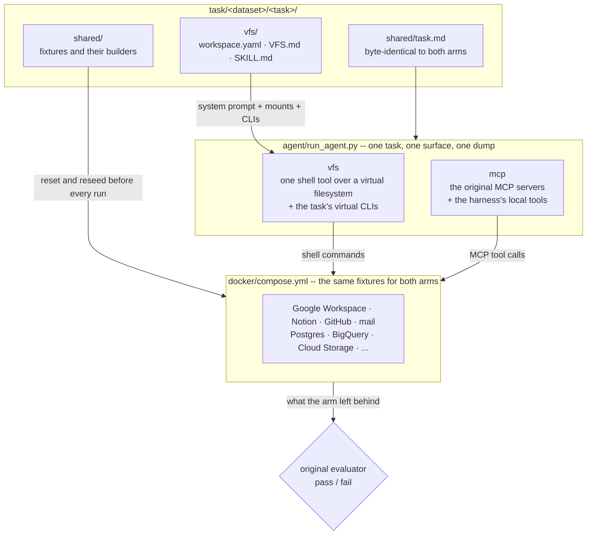

<h1 align="center">
  <a href="https://agentvfs.org/benchmark/vfs-bench-1">
    <picture>
      <source media="(prefers-color-scheme: dark)" srcset="assets/vfs-bench-header-dark.png">
      
    </picture>
  </a>
</h1>

<p align="center">
    <a href="https://agentvfs.org" alt="Website">
        </a>
    <a href="https://agentvfs.org/benchmark/vfs-bench-1/leaderboard" alt="Leaderboard">
        </a>
    <a href="https://agentvfs.org/blogs/agentvfs-1" alt="Blog">
        </a>
    <a href="https://agentvfs.org/vfs" alt="VFS.md">
        </a>
    <br/>
    <a href="https://github.com/strukto-ai/mirage" alt="Built on Mirage">
        </a>
    <a href="https://github.com/agentvfs/vfs-bench/blob/main/LICENSE" alt="License">
        </a>
    <a href="https://discord.gg/u8BPQ65KsS" alt="Discord">
        </a>
</p>

VFS-Bench is **one task, two interfaces**. Every task runs twice: once
through the task's MCP servers, as in the original benchmark, and once
through [AgentVFS](https://agentvfs.org), a virtual filesystem with
[VFS.md](https://agentvfs.org/vfs), where the agent reaches the same
services with shell commands. Each task keeps its original instruction, data
and evaluator, so the two runs differ only in the interface, and the
benchmark measures how often the agent succeeds and how many tokens each
interface costs.

VFS-Bench 1.0 has **200 tasks**, 100 from
[MCP-Atlas](https://arxiv.org/abs/2602.00933) and 100 from
[Toolathlon](https://arxiv.org/abs/2510.25726), over 46 external services
such as email, Canvas, Google Drive and Sheets, GitHub, Notion and Slack.
With a virtual filesystem, agents use **52% fewer tokens** on average than
with MCP tool calling, and pass@1 rises from **77.6% to 81.6%**.

<p align="center">
  <picture>
    <source media="(prefers-color-scheme: dark)" srcset="assets/agentvfs-overview-dark.png">
    
  </picture>
</p>

Here is what the agent is given in the VFS arm of a Toolathlon task over
Google Drive, abridged. It replaces the MCP server's tool schemas:

````markdown
---
name: workspace-filesystem
description: The virtual filesystem layout of this workspace.
---

# Virtual Filesystem

Google Drive is virtualized at `/gd`. Read it with shell commands; spreadsheet
operations are listed in SKILL.md.

| Path | Description |
|---|---|
| `/gd` | Google Drive, read-only. Directories are Drive folders; change spreadsheets with the `google-sheet` CLI. |
````

and the agent works on the data with the tools it already knows. These are
commands from recorded runs of the task:

```bash
find /gd -name '*.gsheet.json'
f="/gd/NHL-B2B-Analysis/NHL 2425 Schedule.gsheet.json"
jq -r '.sheets[0].data[0].rowData[1:][] | [.values[].formattedValue] | @tsv' "$f" > s.tsv
cut -f4 s.tsv | sort | uniq -c
google-sheet create-spreadsheet '{"title":"NHL-B2B-Analysis"}'
google-sheet update-cells "$(jq -c '{spreadsheet_id:"f0003",sheet:"Sheet1",range:"A1:F33",data:.}' out.json)"
```

## About

- **Unified interface.** One virtual filesystem presents every service as
  files and commands, and agents read them live without copying anything
  locally.
- **Performance.** Agents filter and chain data with Unix-like tools and
  scripts, saving more than half of MCP's tokens on average with better
  accuracy.
- **Policy and security.** The filesystem is purely virtual, so a policy
  checks every command and decides what agents may read, change or run,
  keeping secrets and tests out of reach.
- **Same task, same data, same grader.** Both arms get the byte-identical
  task text, the same seeded fixtures and the original, unmodified evaluator;
  services run as local fakes that reproduce their APIs, reset and reseeded
  before every run, so the benchmark reruns without live accounts.
- **Same operations.** The VFS arm's virtual CLIs offer the MCP servers'
  operations with the same arguments, so both interfaces reach the same
  actions. Every divergence from upstream is declared in one file.

AgentVFS has four parts, and VFS-Bench measures them together against MCP:

1. **Virtual Filesystem.** Each service's data appears as files in the shape
   of its API resources, read with `ls`, `grep`, `cat` and `jq`.
2. **VFS.md.** A short Markdown file describes the layout and the file
   formats, so the agent finds the data without trial and error.
3. **Virtual CLIs.** Actions with side effects run as CLIs that SKILL.md
   describes, so every change to a service is an explicit command.
4. **Policy.** Every read, write and command passes through a policy before
   it runs.

## Results

pass@1 and mean total tokens per task (input plus output, over every
request) of each model's first trial, MCP against VFS. The advanced tier runs
at medium reasoning effort and the efficient tier at maximum. The full
leaderboard, every task and every trajectory are on
[agentvfs.org](https://agentvfs.org/benchmark/vfs-bench-1/leaderboard).

| Dataset | Model | MCP pass@1 | VFS pass@1 | MCP tokens | VFS tokens | Token reduction |
| --- | --- | --: | --: | --: | --: | --: |
| MCP-Atlas | Claude Opus 5.5 | 93% | **96%** | 311,129 | **37,744** | **88%** |
| MCP-Atlas | GPT-6.1 Sol | 88% | **90%** | 77,708 | **37,137** | **52%** |
| MCP-Atlas | GPT-5.6 Luna | 81% | **87%** | 205,587 | **106,960** | **48%** |
| MCP-Atlas | Claude Haiku 5.5 | 84% | **89%** | 374,015 | **207,805** | **44%** |
| MCP-Atlas | Gemini 3.8 Flash | 91% | **94%** | 1,343,771 | **745,790** | **45%** |
| Toolathlon | Claude Opus 5.5 | 83% | **86%** | 616,684 | **166,218** | **73%** |
| Toolathlon | GPT-6.1 Sol | 75% | **75%** | 683,010 | **193,372** | **72%** |
| Toolathlon | GPT-5.6 Luna | 61% | **73%** | 3,913,601 | **1,558,475** | **60%** |
| Toolathlon | Claude Haiku 5.5 | 70% | **74%** | 2,823,610 | **2,543,913** | **10%** |
| Toolathlon | Gemini 3.8 Flash | 50% | **52%** | 6,719,002 | **5,070,925** | **25%** |

## Datasets

Tasks are selected from benchmarks of realistic, multi-step tasks over real
MCP servers, preferring tasks that read or change data in several external
services. Each dataset keeps its own agent harness, with its loop, request
limit and context handling, for both arms.

|                   | [MCP-Atlas](vfs-bench-1/task/mcpatlas/README.md) | [Toolathlon](vfs-bench-1/task/toolathlon/README.md) | Total |
| ----------------- | --: | --: | --: |
| Tasks             | 100 | 100 | 200 |
| External services | 24  | 29  | 46  |
| Services as VFS   | 5   | 9   | 13  |
| Virtual CLIs      | 26  | 28  | 51  |

Every service a task reaches, through MCP in one arm and through the virtual
filesystem and its CLIs in the other:

|  | Services |
| --- | --- |
| **Files and Documents** |              |
| **Messaging and Work** |                |
| **Code and ML** |            |
| **Databases and Cloud** |        |
| **Search and Research** |                        |
| **Commerce, Finance and Travel** |                    |

Many services run as local fakes that reproduce their APIs (Google
Workspace, Notion, GitHub, Slack, Airtable, mail, Canvas, WooCommerce,
Kubernetes, BigQuery and Cloud Storage, Snowflake, W&B), so a run needs no
live account and every run starts from the same seeded state.

## Installation

- **Python** ≥ 3.12 with [uv](https://docs.astral.sh/uv/)
- **Node.js** `^22.20 || ^24.12 || >=25`, with pnpm
- **Go**, **Rust** (cargo) and **Docker**

```bash
git clone --recurse-submodules https://github.com/agentvfs/vfs-bench.git
cd vfs-bench/vfs-bench-1 && uv sync
cp .env.example .env.development   # fill in your model provider's key
uv run python setup/setup.py       # --list to see the steps, --from N to resume
```

Setup is safe to re-run: every step checks whether it already ran. Some
servers are installed only for the tasks that need them: MCP-Atlas's server
image, Canvas and WooCommerce, Kubernetes and Helm, the browser, papers and
Forms, Hugging Face, and maps, rail and video.

```bash
for s in mcpatlas commerce_canvas kubernetes helm browser huggingface papers_forms travel_video; do
  uv run python -m server.mcp.setup_$s
done
```

Toolathlon's native Linux tools run under checksum-pinned Sandlock, which
needs Linux 6.12+ with Landlock and seccomp user notification; macOS uses
`sandbox-exec`. `uv run python tests/linux_execution.py` verifies the
boundary on Linux.

## Quickstart

Run one task through both arms, one after the other, since they share the
same live services. Every command runs from `vfs-bench-1/`:

```bash
uv run python agent/run_agent.py toolathlon/nhl-b2b-analysis --tools vfs   # AgentVFS
uv run python agent/run_agent.py toolathlon/nhl-b2b-analysis --tools mcp   # MCP
uv run python agent/run_agent.py mcpatlas/fantasy-sports-average --tools vfs
```

Each run brings the fake services up, empties them, reseeds the task's
fixtures, runs the arm, writes a dump to `dumps/` and grades itself with the
original evaluator:

```
mcp servers=3 tools=50 {'google_sheet': 20, 'filesystem': 14, 'terminal': 2, 'local': 14}
--- usage: requests=12 in=331372 out=1841 ---
dump written to dumps/<timestamp>_mcp_<model>_<effort>_toolathlon_nhl-b2b-analysis.json
All data match!
eval_exit=0
```

`--tools` picks the surface: `vfs` is AgentVFS on
[Mirage](https://github.com/strukto-ai/mirage), `mcp` the original MCP
servers, and `gym` Toolathlon-GYM's PostgreSQL-backed Sheets fork. There is
no switch for skipping the seed or the grade, because a run that skipped
either would be graded on whatever the previous run left behind.

To run your own model, see
[`vfs-bench-1/CUSTOM_MODEL.md`](vfs-bench-1/CUSTOM_MODEL.md).

`bin/start.sh` drives the fake services without a run:

| command | what it does |
|---|---|
| `bin/start.sh up` | build the images, start the fakes, wait for health |
| `bin/start.sh task <task>` | the above, emptied and seeded for one task |
| `bin/start.sh reset` | empty every fake, seed nothing |
| `bin/start.sh status` | health, one line per service |
| `bin/start.sh env` | the exports a shell needs |
| `bin/start.sh down` | stop everything, keep the images |

## How It Works



Three invariants are enforced in code: fixtures are reseeded before each arm,
so the second never inherits the first's answer; tool results are capped at
the dataset's own limit on both sides, with the overflow paged through a
file; and both arms run against the same wall clock. Every divergence from an
upstream MCP server is declared in `server/mcp/mcp_servers.py`, and every
committed fixture traces back to its source through a `dvc.yaml` stage
(`uv run dvc status` names what has drifted).

The benchmark lives in `vfs-bench-1/`, so a later version can sit beside it;
the repository root holds this page, its images, and [`ui/`](ui/README.md), a
page to start and watch `vfs-bench-2/`'s Harbor runs.

```
vfs-bench-1/
  agent/        the loop and both arms -- nothing here names a dataset
  task/         one directory per dataset, each with its own seam (__init__.py)
    mcpatlas/     100 MCP-Atlas tasks
    toolathlon/   100 Toolathlon tasks
  cli/  vfs/    the virtual CLIs and mounts the VFS arm adds to Mirage
  server/       the fake services, their seeders and the MCP arm's launcher
  redirect/     what points upstream's processes at the fakes
  setup/        every install a fresh checkout needs, in order
  submodule/    Toolathlon, toolathlon_gym, mcp-atlas and Mirage, pinned
  dumps/        each run's transcript, gitignored
```

[`vfs-bench-1/task/README.md`](vfs-bench-1/task/README.md) describes what one task directory holds,
and [`vfs-bench-1/vfs/README.md`](vfs-bench-1/vfs/README.md) which layer owns which responsibility.

## Contributing

VFS-Bench is developed in the open. To contribute a dataset or a Mirage
backend to VFS-Bench 2.0, see
[agentvfs.org/contribution](https://agentvfs.org/contribution), or join the
[Discord](https://discord.gg/u8BPQ65KsS).

## Citation

If you find AgentVFS or VFS-Bench useful in your work, please cite it as
follows.

```bibtex
@misc{zhang2026agentvfs,
  title  = {AgentVFS: A Virtual Filesystem Interface for AI Agents},
  author = {Zhang, Zecheng and Li, Guohao and Xiao, Yuxin and He, Yuan and
            Shen, Qijia and Lai, Douglas and Qi, Zhenting and Bevilacqua, Alex and
            Huang, Xingyue and Song, Bowen and Xu, Yue and Zheng, Han and
            Qi, Fangfang and Li, Li and Nkemdilim, Tochukwu and
            Akinyemi, Stephen and Qu, Ao and Cidon, Asaf and You, Jiaxuan and
            Ying, Rex and Luan, Xiaofan and Tang, Siddon},
  year   = {2026},
  month  = oct,
  url    = {https://agentvfs.org/blogs/agentvfs-1}
}
```
