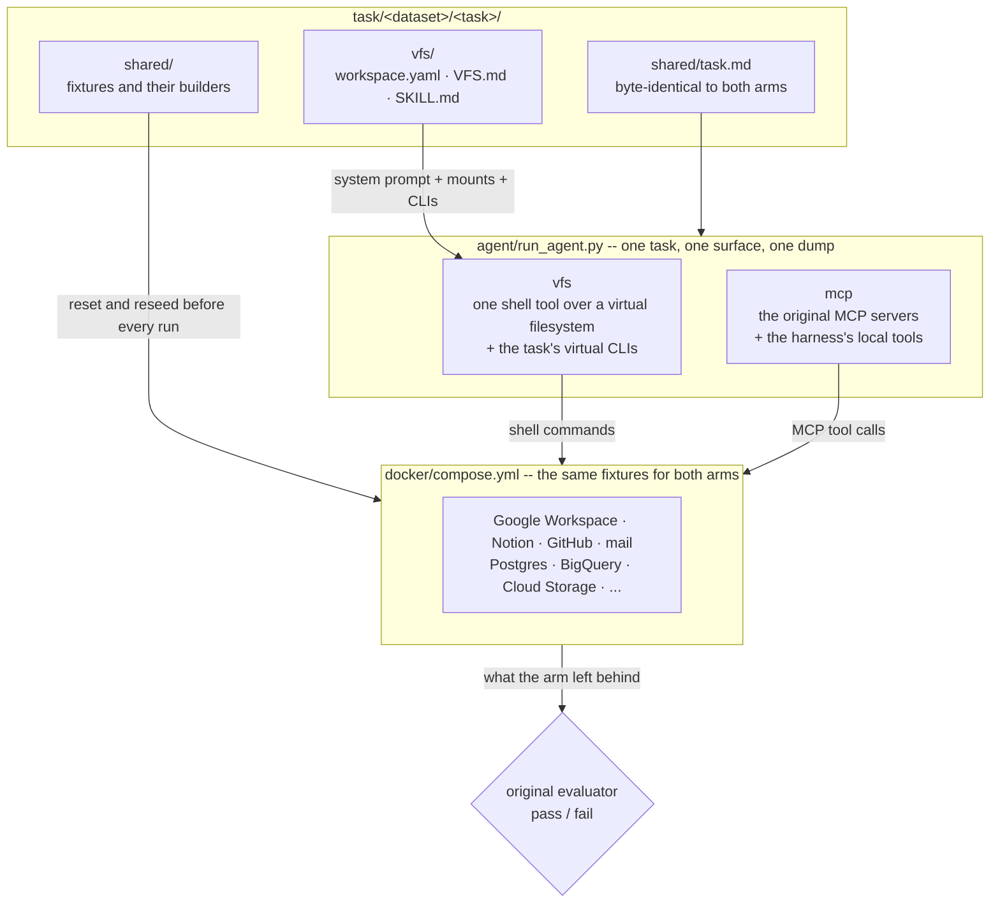

# VFS-Bench 1.0

**One task, two interfaces**: 200 tasks, 100 from
[MCP-Atlas](https://arxiv.org/abs/2602.00933) and 100 from
[Toolathlon](https://arxiv.org/abs/2510.25726), each run once through the
task's MCP servers and once through AgentVFS. The results and the
leaderboard are on the [repository's page](../README.md#results) and
[agentvfs.org](https://agentvfs.org/benchmark/vfs-bench-1/leaderboard).

## Installation

- **Python** ≥ 3.12 with [uv](https://docs.astral.sh/uv/)
- **Node.js** `^22.20 || ^24.12 || >=25`, with pnpm
- **Go**, **Rust** (cargo) and **Docker**

```bash
git clone --recurse-submodules https://github.com/agentvfs/vfs-bench.git
cd vfs-bench/vfs-bench-1 && uv sync
cp .env.example .env.development   # fill in your model provider's key
uv run python setup/setup.py       # --list to see the steps, --from N to resume
```

Setup is safe to re-run: every step checks whether it already ran. Some
servers are installed only for the tasks that need them: MCP-Atlas's server
image, Canvas and WooCommerce, Kubernetes and Helm, the browser, papers and
Forms, Hugging Face, and maps, rail and video.

```bash
for s in mcpatlas commerce_canvas kubernetes helm browser huggingface papers_forms travel_video; do
  uv run python -m server.mcp.setup_$s
done
```

Toolathlon's native Linux tools run under checksum-pinned Sandlock, which
needs Linux 6.12+ with Landlock and seccomp user notification; macOS uses
`sandbox-exec`. `uv run python tests/linux_execution.py` verifies the
boundary on Linux.

## Quickstart

Run one task through both arms, one after the other, since they share the
same live services. Every command runs from `vfs-bench-1/`:

```bash
uv run python agent/run_agent.py toolathlon/nhl-b2b-analysis --tools vfs   # AgentVFS
uv run python agent/run_agent.py toolathlon/nhl-b2b-analysis --tools mcp   # MCP
uv run python agent/run_agent.py mcpatlas/fantasy-sports-average --tools vfs
```

Each run brings the fake services up, empties them, reseeds the task's
fixtures, runs the arm, writes a dump to `dumps/` and grades itself with the
original evaluator:

```
mcp servers=3 tools=50 {'google_sheet': 20, 'filesystem': 14, 'terminal': 2, 'local': 14}
--- usage: requests=12 in=331372 out=1841 ---
dump written to dumps/<timestamp>_mcp_<model>_<effort>_toolathlon_nhl-b2b-analysis.json
All data match!
eval_exit=0
```

`--tools` picks the surface: `vfs` is AgentVFS on
[Mirage](https://github.com/strukto-ai/mirage), `mcp` the original MCP
servers, and `gym` Toolathlon-GYM's PostgreSQL-backed Sheets fork. There is
no switch for skipping the seed or the grade, because a run that skipped
either would be graded on whatever the previous run left behind.

To run your own model, see [CUSTOM_MODEL.md](CUSTOM_MODEL.md).

`bin/start.sh` drives the fake services without a run:

| command | what it does |
|---|---|
| `bin/start.sh up` | build the images, start the fakes, wait for health |
| `bin/start.sh task <task>` | the above, emptied and seeded for one task |
| `bin/start.sh reset` | empty every fake, seed nothing |
| `bin/start.sh status` | health, one line per service |
| `bin/start.sh env` | the exports a shell needs |
| `bin/start.sh down` | stop everything, keep the images |

## How It Works



Three invariants are enforced in code: fixtures are reseeded before each arm,
so the second never inherits the first's answer; tool results are capped at
the dataset's own limit on both sides, with the overflow paged through a
file; and both arms run against the same wall clock. Every divergence from an
upstream MCP server is declared in `server/mcp/mcp_servers.py`, and every
committed fixture traces back to its source through a `dvc.yaml` stage
(`uv run dvc status` names what has drifted).

```
vfs-bench-1/
  agent/        the loop and both arms -- nothing here names a dataset
  task/         one directory per dataset, each with its own seam (__init__.py)
    mcpatlas/     100 MCP-Atlas tasks
    toolathlon/   100 Toolathlon tasks
  cli/  vfs/    the virtual CLIs and mounts the VFS arm adds to Mirage
  server/       the fake services, their seeders and the MCP arm's launcher
  redirect/     what points upstream's processes at the fakes
  setup/        every install a fresh checkout needs, in order
  submodule/    Toolathlon, toolathlon_gym, mcp-atlas and Mirage, pinned
  dumps/        each run's transcript, gitignored
```

[task/README.md](task/README.md) describes what one task directory holds,
and [vfs/README.md](vfs/README.md) which layer owns which responsibility.
