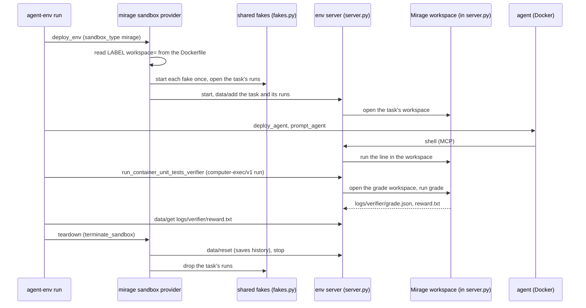

# agent-env

vfs-bench-2 tasks under [agent-env](https://github.com/scaleapi/agentenv-framework)
(`agentenv-framework` 0.9.1634), beside [Harbor](../harbor/README.md). A task's
terminal is its Mirage workspace instead of a Docker container: Mirage's Python
`Workspace`, in the env's own process. Only ComplexMCP has a bundle so far.

## How we integrate

We follow agent-env's terminal-task pattern
([A task without an env](https://www.agentenvframework.com/docs/tasks/more-steps#a-task-without-an-env)),
and plug Mirage in through two of its classes:

- `sandbox.py`: a `SandboxProvider`, registered as `mirage`. Each sandbox is one
  task's env server and its runs on the shared fakes. An env's Dockerfile
  names the task's `workspace.yaml`, and the provider opens that instead of
  building an image.
- `fakes.py`: the fakes a run's tasks share, one per service, as Harbor's job
  shares them. Each task is a run of its own on each: its own SQLite file, and
  a port that reaches that run alone.
- `server.py`: the env's `AgentEnvEnvironment`, holding the task's workspace.
  - The agent's one tool is `shell`, a line in that workspace.
  - The verifier's `computer-exec/v1` `run` goes to a grade workspace over the
    task's frozen state, whose `grade` runs the task's grader in node.
  - `urn:mirage:workspace/v1` `snapshot` answers the task's environment as one
    JSON document: its Mirage workspace (Mirage's own snapshot), its runs on
    the fakes (the kit's `GET /_kit/runs/<run>/snapshot`), the tools' dispatch
    log and its clock. `load` makes the environment a snapshot's. A clone is a
    new env of the task loaded with another's snapshot.
- `tools.py`: the task's tools as CLIs, as `workspace/cli.ts` makes them for
  Harbor's TypeScript Mirage. The agent sees the same `SKILL.md`, help and
  output on either.

The TypeScript daemon's `preload.ts` becomes the workspace's own config: its
`network` (the task's fake runs alone, upstream's ports routed to them) and its
`system_time`. `python3` is CPython's WASI build, where the TypeScript Mirage
runs Pyodide.

Each task runs agent-env's own steps:



A task in `datasets/<dataset>/agentenv/` (written by `bundle.py`):

```
envs/<task>/Dockerfile    LABEL workspace=<the task's workspace.yaml>
envs/<task>/env.toml      environment mirage, server topology
tasks/<task>.json         deploy_env → deploy_agent → prompt_agent
                          → run_container_unit_tests_verifier
```

The verifier's command is
`grade > logs/verifier/grade.json && jq -r .score logs/verifier/grade.json > logs/verifier/reward.txt`,
and its reward file is `logs/verifier/reward.txt`.

## Install

You need Node 24.15 or later (or name a binary with `VFSBENCH_NODE`), uv, and
the Mirage submodule built, as for Harbor. The sync builds Mirage's Python
package from the submodule, which needs `cargo` on `PATH`. From `vfs-bench-2/`:

```sh
uv sync --project formats/agentenv
python3 -I formats/agentenv/python.py   # python3's CPython WASI build, into state/cpython-wasi
```

An agent also needs Docker running, for the agent's own container, and
agent-env's model endpoint: `LITELLM_BASE_URL` and `LITELLM_API_KEY`, or
`[model]` in `.agentenv/config.toml`.

## Run

From `vfs-bench-2/`:

```sh
# Tasks with an agent (Claude Code by default; --agent codex, --model <model>).
# Run ten tasks per run.
uv run --project formats/agentenv agent-env run datasets/complexmcp/agentenv \
  --task apple-watch-delete-history --task banana-peppers-per-neighbor

# Each task's solution/solve.sh, then its test (no agent, no Docker).
uv run --project formats/agentenv python -I formats/agentenv/oracle.py complexmcp [-n 4]

# The same, and a clone of each solved env tested too, and the env loaded back
# to its start.
uv run --project formats/agentenv python -I formats/agentenv/oracle.py complexmcp --clone

# Write or check a bundle, and the tests.
uv run --project formats/agentenv python -I formats/agentenv/bundle.py complexmcp [--check]
uv run --project formats/agentenv python -I formats/agentenv/test_agentenv.py
```

A task's files are under `state/agentenv/<task>-<id>/`:

- `verifier/logs/verifier/grade.json` and `reward.txt`
- `history.jsonl`

The fakes' logs, which a run's tasks share, are under
`state/agentenv/fakes-<pid>/`.

## Memory

ComplexMCP tasks held open, each after its solution, private memory by macOS
`footprint`:

| Tasks | Env servers, Mirage in each | Fakes | Total |
|---|---|---|---|
| 1 | 0.14 GB | 2.55 GB | 2.8 GB |
| 10 | 1.53 GB | 3.33 GB | 5.1 GB |
| 47 | 7.29 GB | 4.31 GB | 12 GB |

The fakes are one set for the run: 15 services, four processes each (the fake,
81 MB; its launcher, 45 MB; tsx, 32 MB; esbuild, 13 MB). Each task adds its env
server, about 0.15 GB (agent-env and Mirage loaded, and its workspaces; 71 MB
more once its `python3` first runs), and its runs on the fakes, about 40 MB.
agent-env holds a task's sandbox until the run ends, so ten tasks a run take
about 5 GB.

On Harbor's TypeScript daemon, a task's server and Mirage took 0.54 GB instead
of 0.15 GB: the daemon 334 MB idle, as it loads all of Mirage at startup (2,476
modules), and 0.1 GB more at its first workspace, where its wasm modules load
and V8 optimizes them.
