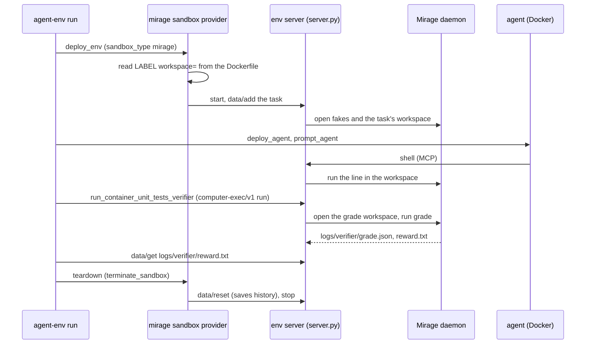

# agent-env

vfs-bench-2 tasks under [agent-env](https://github.com/scaleapi/agentenv-framework)
(`agentenv-framework` 0.9.1634), beside [Harbor](../harbor/README.md). A task's
terminal is its Mirage workspace instead of a Docker container. Only ComplexMCP
has a bundle so far.

## How we integrate

We follow agent-env's terminal-task pattern
([A task without an env](https://www.agentenvframework.com/docs/tasks/more-steps#a-task-without-an-env)),
and plug Mirage in through two of its classes:

- `sandbox.py`: a `SandboxProvider`, registered as `mirage`. Each sandbox is one
  task's Mirage workspace (its fakes, a daemon and the workspace). An env's
  Dockerfile names the task's `workspace.yaml`, and the provider opens that
  instead of building an image.
- `server.py`: the env's `AgentEnvEnvironment`.
  - The agent's one tool is `shell`, on the task's workspace.
  - The verifier's `computer-exec/v1` `run` goes to a grade workspace on the same
    daemon, over the task's frozen state.

Each task runs agent-env's own steps:



A task in `datasets/<dataset>/agentenv/` (written by `bundle.py`):

```
envs/<task>/Dockerfile    LABEL workspace=<the task's workspace.yaml>
envs/<task>/env.toml      environment mirage, server topology
tasks/<task>.json         deploy_env → deploy_agent → prompt_agent
                          → run_container_unit_tests_verifier
```

The verifier's command is
`grade > logs/verifier/grade.json && jq -r .score logs/verifier/grade.json > logs/verifier/reward.txt`,
and its reward file is `logs/verifier/reward.txt`.

## Install

You need Node 24.15 or later (or name a binary with `VFSBENCH_NODE`), uv, and
the Mirage submodule built, as for Harbor. From `vfs-bench-2/`:

```sh
uv sync --project formats/agentenv
```

An agent also needs Docker running, for the agent's own container, and
agent-env's model endpoint: `LITELLM_BASE_URL` and `LITELLM_API_KEY`, or
`[model]` in `.agentenv/config.toml`.

## Run

From `vfs-bench-2/`:

```sh
# Tasks with an agent (Claude Code by default; --agent codex, --model <model>).
# Run ten tasks per run.
uv run --project formats/agentenv agent-env run datasets/complexmcp/agentenv \
  --task apple-watch-delete-history --task banana-peppers-per-neighbor

# Each task's solution/solve.sh, then its test (no agent, no Docker).
uv run --project formats/agentenv python -I formats/agentenv/oracle.py complexmcp [-n 4]

# Write or check a bundle, and the tests.
uv run --project formats/agentenv python -I formats/agentenv/bundle.py complexmcp [--check]
uv run --project formats/agentenv python -I formats/agentenv/test_agentenv.py
```

A task's files are under `state/agentenv/<task>-<id>/`:

- `verifier/logs/verifier/grade.json` and `reward.txt`
- `history.jsonl`
- the daemon's and the fakes' logs

## Memory

One ComplexMCP task (`unblock-relatives`), private memory by macOS `footprint`:

| Part | Memory |
|---|---|
| 15 fakes, each four processes: the fake (81 MB), its launcher (45 MB), tsx (32 MB), esbuild (13 MB) | 2.5 GB |
| Mirage TS daemon, idle | 0.33 GB |
| The daemon's first workspace, once: its wasm modules load, then V8 optimizes them at the first `VFS.md` | 0.1 GB |
| The task workspace | 3 MB |
| The grade workspace | 7 MB |
| `server.py` | 0.1 GB |
| **One task** | **3 GB** |

agent-env runs four tasks at a time, about 12 GB.

Mirage's two daemons on the same pin, each workspace a RAM mount that runs a line:

| Daemon | Idle | First workspace | Each after |
|---|---|---|---|
| TS, from source (as here) | 334 MB | +27 MB | +3 MB |
| TS, built `dist/` | 291 MB | +27 MB | +2 MB |
| Python | 120 MB | +1 MB | +0.2 MB |

The TS daemon loads all of Mirage at startup (2,476 modules). The Python one
imports what it uses (1,170 of its 2,407 modules). These tasks need the TS
daemon, since `workspace/` (the CLIs, `preload.ts`, `grade.ts`) is TypeScript.
